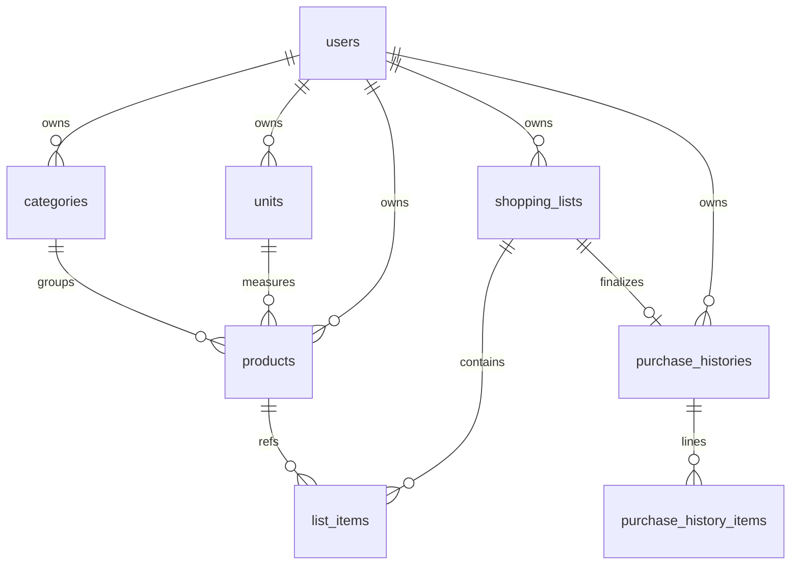
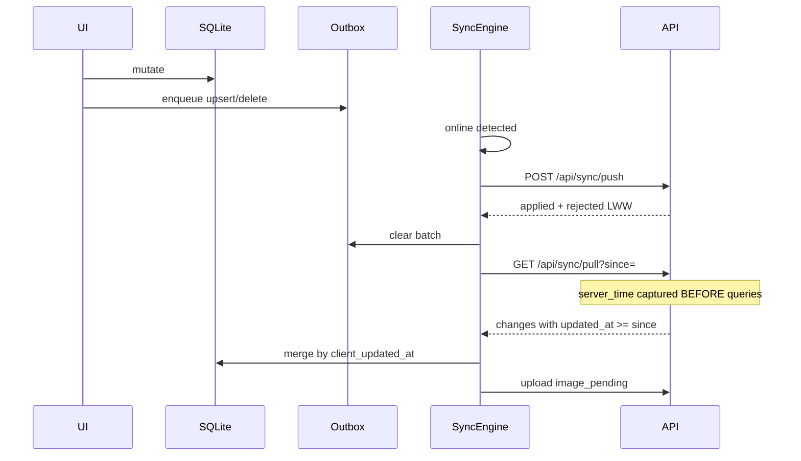

# wi-cart architecture

## Stack

| Layer | Tech | Path |
|-------|------|------|
| API (VPS) | Laravel 11 + Sanctum + MySQL | `apps/api` |
| Client | Flutter (móvil + web) + Drift/SQLite + outbox | `apps/mobile` |
| Dev API | Express JSON store | `apps/dev-api` |

Offline-first: SQLite is the UI source of truth. Server is the multi-device backup/merge plane.

## UI (Material 3)

- Theme: [`apps/mobile/lib/ui/theme/app_theme.dart`](../apps/mobile/lib/ui/theme/app_theme.dart) — bg `#F8F9FA`, cards radius 16, inputs `filled`.
- List detail: `BottomAppBar` + `CircularNotchedRectangle` + FAB `centerDocked` (Lista izq / Carrito der, sin solape).
- Category headers: icon + color + **Total Lista** / **Total Carrito**.

## Domain ERD

### Sync columns (every entity)

`id` (UUID client-generated), `user_id`, `device_id`, `client_updated_at`, `created_at`, `updated_at`, `deleted_at` (soft delete).

### Domain fields

| Entity | Fields |
|--------|--------|
| categories | name, icon, color |
| units | name, abbreviation (`un`,`kg`,`g`,`lts`,`ml`,`paquete`) |
| products | name, description, category_id, unit_id, base_price, image_path, image_pending |
| shopping_lists | name, status (`active`/`completed`), notes, store_location |
| list_items | shopping_list_id, product_id, unit_id, unit_abbr, name, qty_planned, qty_bought, unit_price, status (`pending`/`in_cart`) |
| purchase_histories | shopping_list_id, store_location, purchased_at, total |
| purchase_history_items | purchase_history_id, product_id, name, unit_abbr, quantity, unit_price, line_total |

## Schema reference

### Server (MySQL) — `apps/api/database/migrations/2026_11_04_000010_create_sync_entities_tables.php`

Every synced table: `id` UUID PK, `user_id`, `device_id`, `client_updated_at`, `created_at`, `updated_at`, `deleted_at`.

| Table | Domain columns |
|-------|----------------|
| categories | name, icon, color |
| units | name, abbreviation |
| products | name, description, category_id, unit_id, base_price, image_path, image_pending |
| shopping_lists | name, status, notes, store_location |
| list_items | shopping_list_id, product_id, unit_id, unit_abbr, name, qty_planned, qty_bought, unit_price, status |
| purchase_histories | shopping_list_id, store_location, purchased_at, total |
| purchase_history_items | purchase_history_id, product_id, name, unit_abbr, quantity, unit_price, line_total |

### Local (Drift/SQLite) — `apps/mobile/lib/data/tables.dart`

Mirrors server entities (no `user_id` on rows; scoped by logged-in session wipe).

**Local-only tables/columns (never pushed as entity payloads):**

| Name | Purpose |
|------|---------|
| `products.local_image_path` | On-device photo path before/after upload |
| `sync_outbox` | Pending mutations: entity, id, op, payload_json, client_updated_at, attempts |
| `sync_meta` | Pull cursor (`last_pull_at`) and device id |

SharedPreferences (not SQLite): `last_active_list_id` for cold-start list restore; BCV rates (`bcv_usd_rate`, `bcv_eur_rate`, `bcv_show_eur`, …).

## Currency (USD + Bs BCV)

- Catalog/list prices are stored as **USD**.
- On every cold start, `ExchangeRateService` hits `https://bcv.today/api/v1/rate.json` and caches USD→Bs (and EUR→Bs).
- UI shows `$` + `Bs` equivalent; optional setting **Incluir tasa Euro (BCV)** also shows ≈ € via Bs cross-rate.
- Settings: Listas → ⚙.

## Sync engine

### Rules

1. Mutate SQLite only → enqueue outbox.
2. Online: push → pull → image uploads.
3. Conflict: Last-Write-Wins on `client_updated_at`.
4. Soft deletes via `deleted_at` (tombstones sync).
5. Pull cursor: `server_time` taken before reads; filter `updated_at >= since`.
6. User switch/logout: wipe local SQLite to avoid cross-account leakage.

See [sync-contract.md](sync-contract.md) · [sync-engine.md](sync-engine.md).

## Product autocomplete (offline)

1. User types in add-item sheet → `CartRepository.searchProducts` over local SQLite (prefix / contains / token / levenshtein ≤2).
2. Select hit → fill image, category, unit, base price (overridable for this list line).
3. Unknown name → `addItemSmart` creates global `products` row (outbox) then `list_items` row.
4. Both mutations sync via normal push/pull.

## Session / list UX

- `last_active_list_id` in SharedPreferences; `HomeShell` opens it cold-start.
- `cloneList`: new active list, copy lines as `pending`.
- `clearCart`: all `in_cart` → `pending`.
- Category headers: icon + color swatch (neutral fallback) + name + live **Lista €** / **Carrito €** per category; bottom bar = global (FAB endFloat with right padding so totals stay visible).
