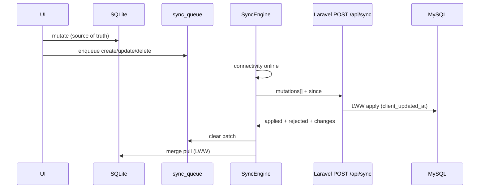

# Sync Engine — Offline-First Bidirectional

## Flow



Rules:
1. **Never** write UI state from API first — local SQLite always.
2. Online: `POST /api/sync` (push batch + pull delta) → image uploads.
3. Conflict: Last-Write-Wins on `client_updated_at`.
4. Soft delete: set `deleted_at`; tombstones sync on pull.
5. Logout / user switch: wipe local DB.

## Local schema (Drift / SQLite)

### Domain tables (sync columns on every entity)

`id` UUID · `user_id` · `device_id` · `client_updated_at` · `created_at` · `updated_at` · `deleted_at`

Entities: `categories`, `units`, `products`, `shopping_lists`, `list_items`, `purchase_histories`, `purchase_history_items`.

### `sync_queue` (outbox)

| Column | Type | Notes |
|--------|------|-------|
| id | TEXT PK | Queue row UUID |
| entity | TEXT | e.g. `products` |
| entity_id | TEXT | Domain row UUID |
| op | TEXT | `create` \| `update` \| `delete` |
| payload_json | TEXT | Entity fields for create/update |
| client_updated_at | DATETIME | LWW clock |
| created_at | DATETIME | Enqueue time |
| attempts | INT | Retry counter |
| last_error | TEXT? | Last failure |

Coalesce: one pending row per `(entity, entity_id)` — latest wins.

### `sync_meta`

| key | value |
|-----|-------|
| `last_pull_at` | ISO server_time cursor |

## Server schema (MySQL)

Same domain tables + Sanctum tokens. Soft deletes via `deleted_at`. See migration `2026_11_04_000010_create_sync_entities_tables.php`.

## API

| Method | Path | Role |
|--------|------|------|
| `POST` | `/api/sync` | **Unified**: apply mutations + return changes since |
| `POST` | `/api/sync/push` | Mutations only |
| `GET` | `/api/sync/pull?since=` | Delta only |
| `POST` | `/api/uploads/product-image` | Deferred images |

### `POST /api/sync`

Request:

```json
{
  "device_id": "uuid",
  "since": "2026-11-04T12:00:00.000Z",
  "mutations": [
    {
      "entity": "categories",
      "id": "uuid",
      "op": "create",
      "client_updated_at": "2026-11-04T12:00:01.000Z",
      "payload": { "name": "Lácteos", "icon": "dairy", "color": "#1565C0" }
    }
  ]
}
```

Ops accepted: `create` | `update` | `upsert` | `delete` (create/update/upsert → upsert).

Response: `{ server_time, applied, rejected, changes, since }`.

## Flutter files

| File | Role |
|------|------|
| `lib/data/tables.dart` | Drift tables incl. `sync_queue` |
| `lib/data/outbox.dart` | `OutboxWriter` + `SyncOp` |
| `lib/data/repository.dart` | Local-first writes → enqueue |
| `lib/sync/sync_engine.dart` | Connectivity + `/api/sync` + merge |
| `lib/services/api_client.dart` | HTTP |

## Laravel files

| File | Role |
|------|------|
| `app/Http/Controllers/SyncController.php` | `sync` / `push` / `pull` |
| `app/Services/SyncService.php` | LWW apply + pull cursor |
| `routes/api.php` | Sanctum-protected routes |
